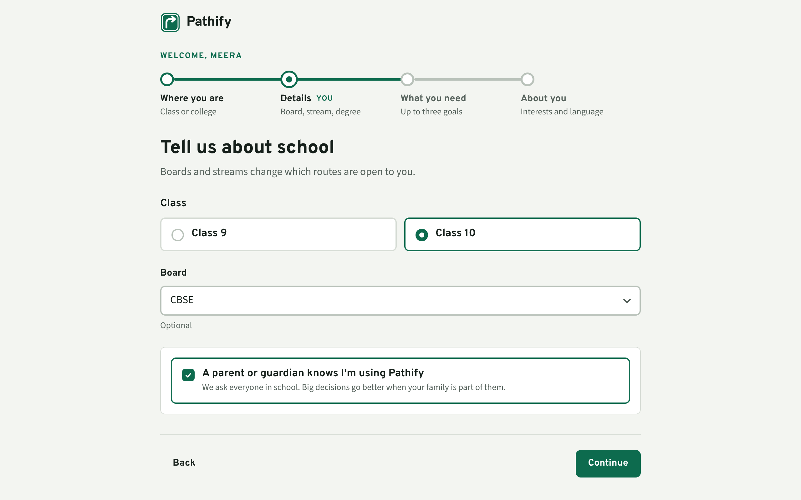
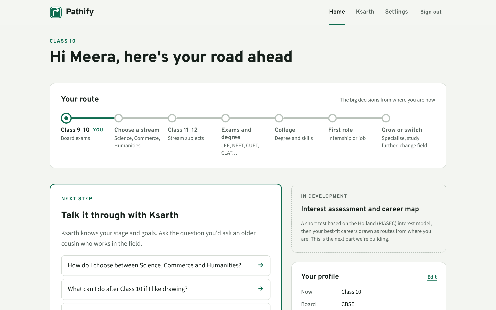
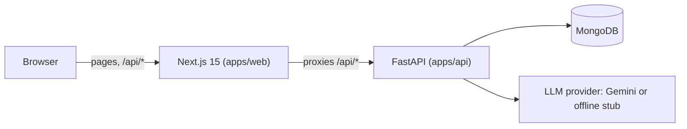

# Pathify

Career guidance for Indian students from Class 9 to college. Pathify helps a student choose a stream after Class 10, pick entrance exams and a degree after Class 12, and get ready for a first job, with reasons they can explain to their parents.


| Onboarding | Home |
| --- | --- |
|  |  |

## What works today

- **Accounts**: email and password, plus Google, GitHub and LinkedIn when configured. The UI only shows buttons for providers that are set up.
- **Onboarding** for four stages (Class 9–10, Class 11–12, college, graduate). Each stage asks only what applies to it, and school students confirm a parent or guardian knows they use Pathify.
- **Home** shows the decisions ahead of the student as a route, starting where they are now.
- **Ksarth**, an AI guide that knows the student's stage, stream, goals and interests. Replies stream in, history is saved, and Ksarth can answer in Hindi.
- **Settings**: name, light / dark / system theme, sign out, and full account deletion.

Coming next: an adaptive interest assessment based on the Holland (RIASEC) model, a personal career metro map, job tryouts, and a parent report.

## Architecture



The browser only ever talks to the web app's origin. Next.js forwards `/api/*` to FastAPI, so auth cookies are first-party and there is no CORS to get wrong.

Decisions worth knowing about:

| Area | Choice | Why |
| --- | --- | --- |
| Sessions | 15-minute access token and 30-day refresh token, both in httpOnly cookies. The refresh cookie is scoped to `/api/auth`. | JavaScript can't read either token, so an XSS bug can't steal a session. |
| Refresh | Every refresh token works once. Reusing an old one revokes the whole token family. | A stolen refresh token stops working as soon as either party uses it. |
| CSRF | SameSite=Lax cookies plus an Origin / Referer check on every write. | Two independent layers. |
| Passwords | Argon2. v1 bcrypt hashes are accepted and upgraded on the next sign-in. | Existing users keep working without a reset. |
| OAuth | `state` stored in a short-lived httpOnly cookie and compared in constant time. Only provider-verified emails can link to an existing account. | Stops login CSRF and account takeover by unverified email. |
| AI | One `LLMProvider` interface. Gemini sends the key in a header, retries transient errors, and never retries a stream that already sent text. | Model failures show an honest error. Nothing falls back to made-up answers. |
| Limits | Per-user Ksarth quota, per-email and per-IP login limits, per-network sign-up limit (30 an hour by default, since a school lab shares one IP). | Protects the AI budget and slows brute force. In-memory for one instance; Redis when there are more. |
| Types | The web client is generated from FastAPI's OpenAPI schema with `openapi-typescript`. CI fails if the two drift apart. | A renamed field breaks the build, not production. |
| Data | `User` documents stay compatible with the v1 schema. | The existing database keeps working. |

## Repository layout

```
apps/api      FastAPI app, tests and Dockerfile
apps/web      Next.js app, Playwright tests and Dockerfile
legacy/       The v1 HTML pages, backends and ML model, kept for reference while porting
scripts/      purge_secrets_from_history.py
docs/         Screenshots
```

## Run it

### With Docker

```bash
cp .env.example .env
```

Set `SECRET_KEY` in `.env` (and `GEMINI_API_KEY` for real Ksarth replies), then:

```bash
docker compose up --build
```

Open http://localhost:3000.

### Without Docker

You need Python 3.12+, Node 22 and a MongoDB on `localhost:27017`.

```bash
cd apps/api && python -m venv .venv && .venv/bin/pip install -r requirements-dev.txt
```

```bash
cd apps/api && .venv/bin/uvicorn app.main:app --reload --port 8000
```

```bash
cd apps/web && npm install && npm run dev
```

Without `GEMINI_API_KEY`, Ksarth runs in offline mode and says so on screen.

### Configuration

All settings are environment variables; see [`.env.example`](.env.example).

| Variable | Default | Notes |
| --- | --- | --- |
| `SECRET_KEY` | `change-me` | Required in production (32+ random characters). |
| `WEB_ORIGIN` | `http://localhost:3000` | Public URL of the web app. Must be https in production. |
| `DATABASE_URL`, `DATABASE_NAME` | local MongoDB, `pathify_db` | |
| `GEMINI_API_KEY`, `GEMINI_MODEL` | empty, `gemini-2.5-flash` | Empty key means offline stub. |
| `GOOGLE_CLIENT_ID`, `GITHUB_CLIENT_*`, `LINKEDIN_CLIENT_*` | empty | OAuth redirect URIs are `{WEB_ORIGIN}/api/auth/{github,linkedin}/callback`. |
| `KSARTH_MESSAGES_PER_HOUR` | `30` | Per student. |
| `SIGNUPS_PER_HOUR_PER_NETWORK` | `30` | Raise it for a school deployment. |
| `API_INTERNAL_URL` | `http://localhost:8000` | Where the web app forwards `/api/*`. Read at build time. |

The API reads `X-Forwarded-For` for rate limiting, so keep it reachable only through the web app, as the compose file does.

## Tests

```bash
cd apps/api && .venv/bin/pytest
```

61 tests run against a real MongoDB (set `TEST_DATABASE_URL` if it isn't on localhost). They cover sign-up, sign-in, refresh-token reuse, OAuth state, origin checks, rate limits, profile validation, account deletion, Ksarth streaming and the Gemini client.

```bash
cd apps/web && npm run lint && npm run typecheck && npm run build
```

```bash
cd apps/web && npx playwright test
```

The end-to-end suite runs against the full stack on a desktop and a phone viewport. It walks through sign-up, onboarding, Ksarth, theme, sign-out, sign-in and account deletion, checks that model output can't inject HTML, checks that an expired access token refreshes silently, and fails if any page scrolls sideways.

CI (`.github/workflows/ci.yml`) runs all of the above on every pull request.

## Security notes

Real API keys were committed to this repository's history before v2. They must be rotated with each provider; rewriting history doesn't make leaked keys safe. After rotating, `scripts/purge_secrets_from_history.py` removes every committed `.env` file and redacts the leaked values from all commits. It then has to be force-pushed, and every existing clone re-cloned.
