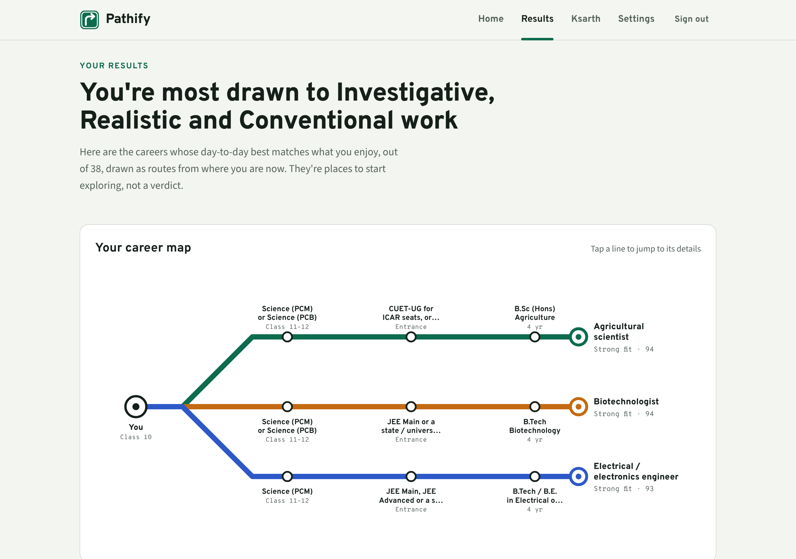
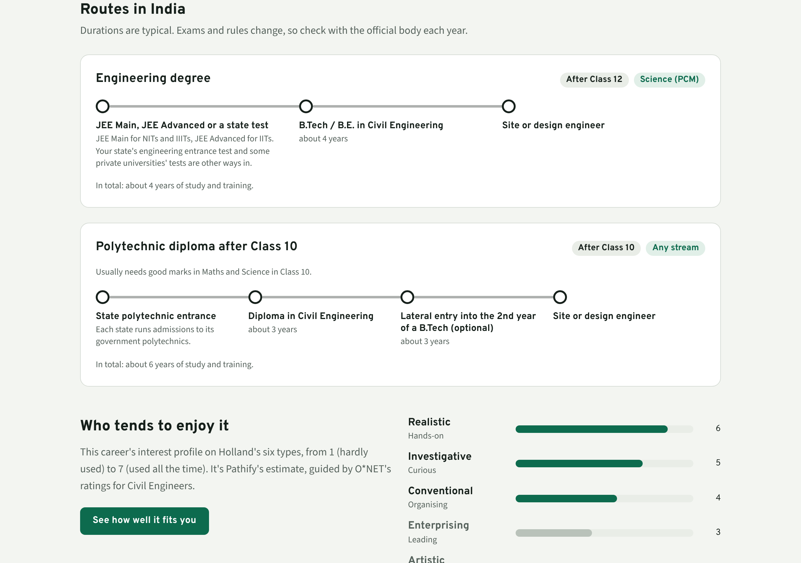
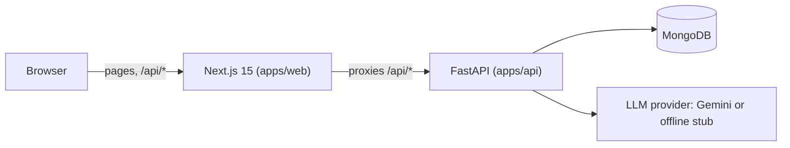

# Pathify

Career guidance for Indian students from Class 9 to college. Pathify helps a student choose a stream after Class 10, pick entrance exams and a degree after Class 12, and get ready for a first job, with reasons they can explain to their parents.




| Assessment | Career guide |
| --- | --- |
|  |  |
| **Onboarding** | **Home** |
|  |  |

## What works today

- **Accounts**: email and password, plus Google, GitHub and LinkedIn when configured. The UI only shows buttons for providers that are set up.
- **Onboarding** for four stages (Class 9–10, Class 11–12, college, graduate). Each stage asks only what applies to it, and school students confirm a parent or guardian knows they use Pathify.
- **Home** shows the decisions ahead of the student as a route, starting where they are now, plus their assessment progress or top matches.
- **Interest assessment**: 30 everyday activities (48 if the student wants a sharper result), scored on Holland's six interest types (RIASEC). Students can go back, leave and resume.
- **Results**: the student's top three careers drawn as metro lines from where they are now, through each real step (stream, entrance exam, degree) to the career. Every match explains why it fits, what to keep in mind, and whether the student's stream allows the route. The page also says how settled the result is.
- **Career library**: a public, statically generated guide to 38 careers across health, engineering, design, law, business, science, public service and skilled trades, filterable by stream. No account needed, so it can be found through search.
- **Ksarth**, an AI guide that knows the student's stage, stream, goals, interest results and top matches. Replies stream in, history is saved, and Ksarth can answer in Hindi.
- **Settings**: name, light / dark / system theme, sign out, and full account deletion.

Coming next: job tryouts (short tasks from real jobs), a parent report in English and Hindi, a Hindi interface, and progress tracking along a chosen route.

## How matching works, and how well

**Scoring.** Each answer updates a running estimate of how much the student enjoys each of the six interest types, with an uncertainty that shrinks as answers come in (a conjugate normal model). The results page shows that uncertainty as a bracket on each score.

**Fit.** Each career has a six-part interest profile. Fit is the correlation between the student's profile and the career's, so it rewards the same *shape* of interests rather than simply liking everything. Each interest type's share of that correlation becomes the explanation on the card ("You enjoy investigating and solving problems, and this career is full of it").

**Accuracy, measured by simulation.** `scripts/simulate_assessment.py` creates students with known interests, has them answer with realistic noise (some statements are more appealing than others, and people aren't perfectly consistent), and checks how many of their true top-5 careers the test finds:

| Questions | True top-5 careers found | True top interest found |
| ---: | ---: | ---: |
| 18 | 65% | 67% |
| 24 | 69% | 70% |
| **30 (default)** | **71%** | **72%** |
| 36 | 74% | 74% |
| 48 (optional) | 77% | 77% |

Even all 48 statements find only about 4 of the 5 true top careers, because neighbouring careers are close together. That is why the product says "places to start exploring, not a verdict", and why job tryouts come next.

**The adaptive test we didn't ship.** The first design picked each next question adaptively, and later tried stopping once the career list stopped moving. Measured against a balanced test of the same length, neither helped (70.6% vs 70.5% top-5 agreement over 1,000 simulated students). With statements that are interchangeable within a type and not yet calibrated on real students, accuracy depends on how many questions are answered, not which. So the shipped test is a balanced 30, with an optional 18 more. Adaptive selection becomes worthwhile once real responses let us calibrate each statement (item response theory).

**Confidence.** The result is labelled high, medium or low by nudging each score up and down by its own uncertainty and counting how many top-5 careers change. In simulation this tracks real accuracy: a list that doesn't move finds about 95% of the true top five; one that moves by two careers finds about 61%. A test checks that the labels stay in that order.

**Where the career data comes from.** `data/careers.json` is written by hand: routes, entrance exams, degrees and typical durations in India, plus the official body to check with. Interest profiles are Pathify's estimates on a 1–7 scale, guided by O*NET's ratings for the similar U.S. occupation named on each career. The catalog deliberately has no salaries or cut-offs, because we can't source and date them yet. A test fails if one slips in. Replacing the estimates with O*NET's published interest data (CC BY 4.0) is a planned improvement.

## Architecture



The browser only ever talks to the web app's origin. Next.js forwards `/api/*` to FastAPI, so auth cookies are first-party and there is no CORS to get wrong.

Decisions worth knowing about:

| Area | Choice | Why |
| --- | --- | --- |
| Sessions | 15-minute access token and 30-day refresh token, both in httpOnly cookies. The refresh cookie is scoped to `/api/auth`. | JavaScript can't read either token, so an XSS bug can't steal a session. |
| Refresh | Every refresh token works once. Reusing an old one revokes the whole token family. | A stolen refresh token stops working as soon as either party uses it. |
| CSRF | SameSite=Lax cookies plus an Origin / Referer check on every write. | Two independent layers. |
| Passwords | Argon2. v1 bcrypt hashes are accepted and upgraded on the next sign-in. | Existing users keep working without a reset. |
| OAuth | `state` stored in a short-lived httpOnly cookie and compared in constant time. Only provider-verified emails can link to an existing account. | Stops login CSRF and account takeover by unverified email. |
| AI | One `LLMProvider` interface. Gemini sends the key in a header, retries transient errors, and never retries a stream that already sent text. | Model failures show an honest error. Nothing falls back to made-up answers. |
| Limits | Per-user Ksarth quota, per-email and per-IP login limits, per-network sign-up limit (30 an hour by default, since a school lab shares one IP). | Protects the AI budget and slows brute force. In-memory for one instance; Redis when there are more. |
| Types | The web client is generated from FastAPI's OpenAPI schema with `openapi-typescript`. CI fails if the two drift apart. | A renamed field breaks the build, not production. |
| Data | `User` documents stay compatible with the v1 schema. | The existing database keeps working. |
| Career data | One JSON source in `data/`, validated by the API at startup and in CI, and imported by the web app at build time for static career pages. | The API and the public pages can't disagree. |

## Repository layout

```
apps/api      FastAPI app, tests, assessment simulation and Dockerfile
apps/web      Next.js app, Playwright tests and Dockerfile
data/         Career catalog and assessment statements, shared by both apps
legacy/       The v1 HTML pages, backends and ML model, kept for reference while porting
scripts/      purge_secrets_from_history.py
docs/         Screenshots
```

## Run it

### With Docker

```bash
cp .env.example .env
```

Set `SECRET_KEY` in `.env` (and `GEMINI_API_KEY` for real Ksarth replies), then:

```bash
docker compose up --build
```

Open http://localhost:3000.

### Without Docker

You need Python 3.12+, Node 22 and a MongoDB on `localhost:27017`.

```bash
cd apps/api && python -m venv .venv && .venv/bin/pip install -r requirements-dev.txt
```

```bash
cd apps/api && .venv/bin/uvicorn app.main:app --reload --port 8000
```

```bash
cd apps/web && npm install && npm run dev
```

Without `GEMINI_API_KEY`, Ksarth runs in offline mode and says so on screen.

### Configuration

All settings are environment variables; see [`.env.example`](.env.example).

| Variable | Default | Notes |
| --- | --- | --- |
| `SECRET_KEY` | `change-me` | Required in production (32+ random characters). |
| `WEB_ORIGIN` | `http://localhost:3000` | Public URL of the web app. Must be https in production. |
| `DATABASE_URL`, `DATABASE_NAME` | local MongoDB, `pathify_db` | |
| `GEMINI_API_KEY`, `GEMINI_MODEL` | empty, `gemini-2.5-flash` | Empty key means offline stub. |
| `GOOGLE_CLIENT_ID`, `GITHUB_CLIENT_*`, `LINKEDIN_CLIENT_*` | empty | OAuth redirect URIs are `{WEB_ORIGIN}/api/auth/{github,linkedin}/callback`. |
| `KSARTH_MESSAGES_PER_HOUR` | `30` | Per student. |
| `SIGNUPS_PER_HOUR_PER_NETWORK` | `30` | Raise it for a school deployment. |
| `API_INTERNAL_URL` | `http://localhost:8000` | Where the web app forwards `/api/*`. Read at build time. |

The API reads `X-Forwarded-For` for rate limiting, so keep it reachable only through the web app, as the compose file does.

## Tests

```bash
cd apps/api && .venv/bin/pytest
```

95 tests run against a real MongoDB (set `TEST_DATABASE_URL` if it isn't on localhost). They cover sign-up, sign-in, refresh-token reuse, OAuth state, origin checks, rate limits, profile validation, account deletion, Ksarth streaming, the Gemini client, the career data, scoring, matching and explanations, stream rules, the assessment flow, and the simulated accuracy figures quoted above.

```bash
cd apps/api && .venv/bin/python -m scripts.simulate_assessment 2000
```

```bash
cd apps/web && npm run lint && npm run typecheck && npm run build
```

```bash
cd apps/web && npx playwright test
```

The end-to-end suite runs against the full stack on a desktop and a phone viewport. It walks through sign-up, onboarding, Ksarth, theme, sign-out, sign-in and account deletion; takes the full assessment as a Class 11 Commerce student, including going back and resuming; checks the results map, explanations and stream rules; and browses the public career library. It also checks that model output can't inject HTML, that an expired access token refreshes silently, and that no page scrolls sideways.

CI (`.github/workflows/ci.yml`) runs all of the above on every pull request.

## Security notes

Real API keys were committed to this repository's history before v2. They must be rotated with each provider; rewriting history doesn't make leaked keys safe. After rotating, `scripts/purge_secrets_from_history.py` removes every committed `.env` file and redacts the leaked values from all commits. It then has to be force-pushed, and every existing clone re-cloned.
